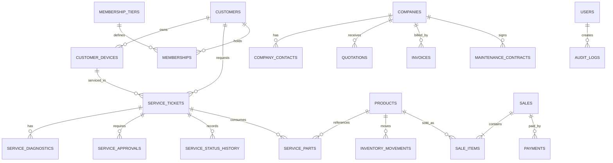

# Database Schema — Rancangan Konseptual

- Status: Proposed; belum menjadi schema Prisma/migrasi aktual.
- Database: PostgreSQL lokal untuk development (disetujui owner, Change 012 & ADR-001); provider production belum dipilih (TBD).
- ORM: Prisma ORM (disetujui owner, Change 018 & ADR-003).
- Semua nama tabel/kolom berikut adalah kandidat untuk diskusi.

## 1. Prinsip data
- Gunakan primary key stabil dan foreign key untuk relasi.
- Simpan `created_at` dan `updated_at` pada entitas mutable; audit record memiliki waktu kejadian.
- Simpan uang menggunakan tipe decimal/fixed precision, bukan floating point.
- Kuantitas stok harus mendukung unit yang ditetapkan.
- Transaksi POS, pergerakan stok, dan pembayaran perlu konsistensi atomik.
- Jangan hard-delete catatan finansial atau audit tanpa kebijakan retensi yang disetujui.
- Zona waktu penyimpanan dan format mata uang: usulan UTC untuk timestamp; mata uang utama IDR, perlu konfirmasi.

## 2. Entitas kandidat
| Entitas | Fungsi | Catatan |
|---|---|---|
| users | Akun internal dan akun portal | Strategi autentikasi TBD |
| roles | Role sistem | Owner/Admin/Cashier sebagai baseline |
| permissions | Hak per tindakan | Granularitas final TBD |
| role_permissions / user_permissions | Relasi pemberian izin | Perlu aturan override yang eksplisit |
| audit_logs | Aksi sensitif dan perubahan permission | Hindari menyimpan secret |
| customers | Pelanggan B2C | Data pribadi minim sesuai kebutuhan |
| customer_devices | Perangkat milik pelanggan | Serial number opsional dan sensitif sesuai konteks |
| service_tickets | Tiket servis | Nomor tiket unik; status tervalidasi |
| service_diagnostics | Diagnosis dan estimasi | Bisa punya riwayat/revisi |
| service_approvals | Persetujuan estimasi | Waktu, kanal, versi estimasi |
| service_status_history | Riwayat status | Actor, waktu, status asal/tujuan |
| service_parts | Suku cadang yang digunakan | Hubungkan ke pergerakan stok |
| service_warranties | Garansi servis | Syarat dan periode |
| products | Produk jual dan suku cadang | SKU/barcode unik sesuai aturan |
| product_categories | Kategori produk | Struktur kategori TBD |
| inventory_movements | Mutasi stok | Append-only lebih aman |
| stocktakes / stocktake_items | Stock opname | Simpan hasil hitung dan selisih |
| suppliers | Supplier | Informasi bisnis |
| purchase_orders / purchase_items | Pembelian/penerimaan | Alur status TBD |
| sales / sale_items | Transaksi POS dan item | Snapshot harga saat transaksi |
| payments | Pembayaran lintas modul | Metode/status/ref eksternal |
| returns / return_items | Retur penjualan | Kebijakan restock TBD |
| companies / company_contacts | Perusahaan dan PIC | Isolasi tenant B2B |
| quotations / quotation_items | Penawaran harga | Versi dan masa berlaku TBD |
| invoices / invoice_items | Invoice | Nomor dan pajak TBD |
| procurement_requests | Permintaan pengadaan B2B | Workflow approval TBD |
| installation_projects | Proyek instalasi | Scope dan milestone TBD |
| maintenance_contracts | Kontrak maintenance | SLA dan renewal TBD |
| membership_tiers | Definisi tier | Harga/benefit TBD |
| memberships | Keanggotaan pelanggan | Masa aktif dan status |
| membership_payment_reviews | Verifikasi transfer manual | Verifier dan bukti disamarkan |
| expenses | Pengeluaran operasional | Kategori dan approval TBD |
| notification_outbox | Notifikasi yang akan dikirim | Jika mekanisme outbox dipilih |

## 3. ERD tingkat konseptual

## 4. Integritas dan constraint yang perlu dirancang
- Unique: nomor tiket, SKU/barcode sesuai aturan bisnis, nomor transaksi, nomor invoice/quotation pada scope yang sesuai.
- Check: jumlah dan nominal tidak negatif kecuali representasi koreksi yang eksplisit.
- Status: enum atau tabel status dengan transisi yang divalidasi di domain layer.
- Snapshot: harga, deskripsi item, diskon, dan pajak transaksi disimpan sesuai kebutuhan audit agar perubahan katalog tidak mengubah transaksi lama.
- Stok: mutasi stok menjadi sumber jejak; stok tersedia tidak boleh berubah tanpa movement yang dapat ditelusuri.
- B2B: setiap query portal harus dibatasi berdasarkan company ID yang diotorisasi.
- Payment: simpan status, metode, nominal, waktu, actor/verifier, dan referensi yang diperlukan; jangan simpan data kartu.
- Approval estimasi: hubungkan persetujuan dengan versi estimasi yang tepat.
- Retur dan refund: kebijakan akuntansi serta restock TBD.

## 5. Audit dan privasi
Audit log minimal mencatat actor, action, entity type/id, timestamp, correlation/reference ID, serta perubahan yang aman untuk disimpan. Hindari merekam seluruh payload yang mungkin mengandung PII atau secret. Tentukan retention period sebelum production.

## 6. Field minimum tiket servis (MVP)

Field minimum untuk tiket servis pada MVP, dengan klasifikasi wajib/opsional:

| Field | Keterangan | Wajib? |
|---|---|---|
| Nomor tiket + mekanisme verifikasi tracking | Kode tiket yang sulit ditebak; token/verifikasi terpisah untuk akses detail publik. | Wajib |
| Referensi pelanggan | FK ke entitas pelanggan. | Wajib |
| Identitas perangkat | Tipe/brand dasar; serial number opsional dan sensitif sesuai konteks. | Opsional |
| Keluhan ringkas | Deskripsi keluhan awal. | Wajib |
| Kondisi awal | Catatan kondisi perangkat saat diterima. | Opsional |
| Waktu penerimaan | Timestamp penerimaan tiket. | Wajib |
| Penugasan pelaksana | FK ke user internal yang ditugaskan (role pelaksana TBD). | Opsional |
| Diagnosis | Catatan diagnosis teknis. | Opsional |
| Estimasi biaya | Nominal estimasi (decimal). Wajib jika alur estimasi digunakan; opsional jika keluar dari alur estimasi. | Conditional |
| Persetujuan pelanggan | Record approval (waktu, kanal, referensi estimasi). Opsional jika tidak ada alur approval. | Conditional |
| Status | Enum status dengan transisi divalidasi di domain layer. | Wajib |
| Riwayat status | Append-only history: status asal/tujuan, aktor, timestamp, alasan. | Wajib |
| Catatan pengerjaan | Catatan teknis internal selama kerja. | Opsional |
| Penyelesaian/serah terima | Bukti/ekstensi penyerahan saat tiket ditutup. | Opsional (wajib untuk alur penutupan berbasis serah terima). |

Catatan:
- Foto perangkat **bukan** field dependensi MVP awal; menjadi kandidat fitur berikutnya.
- Jangan menambahkan field database yang belum didukung kebutuhan bisnis tanpa mencantumkan alasan.

## 7. Keputusan TBD
- ID strategy (UUID/ULID/sequence).
- Naming convention database dan Prisma.
- Soft delete versus status/archive per entitas.
- Mata uang, timezone, precision decimal.
- Metode valuasi stok (FIFO/average/other).
- Struktur payment lintas modul.
- Nomor dokumen dan reset period.
- Kebutuhan multi-company tenancy di masa depan.
- Retensi audit log, lampiran, dan data pelanggan.
- Kebijakan backup dan restore.
