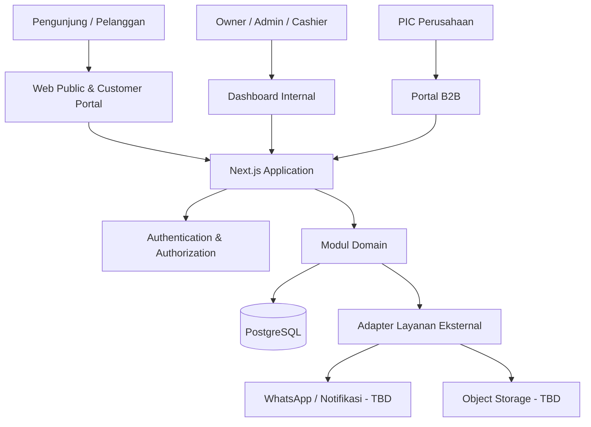

# System Design

- Status: Proposed
- Baseline: 2026-10-28
- Catatan: semua diagram dan modul di sini adalah rancangan, bukan sistem yang sudah berjalan.

## 1. Prinsip
- Modular monolith dalam satu repository untuk mengurangi kompleksitas operasional awal.
- Pisahkan domain bisnis melalui batas modul yang jelas.
- Validasi dan otorisasi di server.
- Transaksi database untuk operasi yang perlu konsistensi.
- Integrasi eksternal dibungkus adapter agar provider dapat diganti.
- Setiap perubahan memiliki jejak dokumentasi dan verifikasi.

## 2. Stack yang direncanakan
| Area | Rencana | Status |
|---|---|---|
| Web framework | Next.js App Router | Proposed |
| Bahasa | TypeScript | Proposed |
| UI styling | Tailwind CSS | Proposed |
| Database | PostgreSQL (lokal untuk development; provider production TBD) | CONFIRMED (dev) |
| ORM | Prisma ORM (Disetujui Owner — ADR-003) | Disetujui Owner |
| Authentication | Better Auth (ADR-002) — MFA wajib Owner/Admin; sesi absolut 8 jam / idle 30 mnt; single role MVP | Disetujui Owner (implementasi TBD) |
| Hosting | Cloud/VPS | Pilihan rinci TBD |
| Object storage | TBD | Untuk lampiran jika diperlukan |
| Notifications | WhatsApp dan kanal lain TBD | Provider belum dipilih |
| Monitoring | TBD | Perlu dipilih sesuai hosting |

## 3. Konteks sistem

## 4. Modul domain
- **Identity & Access:** user, session, role/permission, audit.
- **Customer & Company:** pelanggan individu, perusahaan, PIC.
- **Service Management:** tiket servis, perangkat, diagnosis, estimasi, approval, status, garansi.
- **Catalog:** layanan dan produk yang ditampilkan publik.
- **Inventory & Procurement:** produk, stok, supplier, pembelian, opname.
- **POS & Sales:** cart/line items, transaksi, diskon, pembayaran, struk, retur.
- **B2B Operations:** quotation, invoice, procurement request, instalasi, maintenance contract.
- **Membership:** tier, periode, pendaftaran, pembayaran dan verifikasi.
- **Finance & Reporting:** transaksi keuangan operasional dan laporan yang disetujui.
- **Notifications:** pembuatan event dan pengiriman via provider yang dipilih.
- **Documentation/Audit:** audit event dan catatan perubahan yang dikelola di repository.

## 5. Pola request
1. Client mengirim request ke route/server action yang sesuai.
2. Server memvalidasi bentuk dan isi input.
3. Identitas pengguna diverifikasi bila operasi memerlukan login.
4. Permission serta batas kepemilikan data diperiksa di server.
5. Domain service menjalankan aturan bisnis.
6. Database transaction digunakan untuk operasi multi-record yang harus atomik.
7. Hasil dikembalikan dengan response yang tidak membocorkan detail internal.
8. Aksi sensitif dicatat dalam audit log.
9. Notifikasi eksternal dikirim melalui mekanisme yang tahan kegagalan; strategi queue/retry masih TBD.

## 6. Keamanan dan konsistensi
- Jangan mengandalkan guard UI saja.
- Pisahkan autentikasi dari otorisasi.
- Terapkan company scoping untuk portal B2B.
- Nomor tiket bukan pengganti authorization; gunakan token/verification yang aman jika menampilkan informasi lebih dari status minimal.
- Gunakan idempotency untuk callback atau operasi pembayaran yang berisiko duplikasi.
- Jangan menghapus catatan transaksi finansial tanpa kebijakan koreksi yang jelas.
- Detail audit log, retention, dan akses audit: lihat `SECURITY.md` dan `DATABASE_SCHEMA.md`.

## 7. Deployment dan lingkungan
Rancangan environment: local development, test/CI, staging bila tersedia, dan production. Detail provider dan pipeline belum diputuskan. Secret disediakan melalui environment/secret manager, bukan committed file.

## 8. Keputusan arsitektur yang belum final
- Provider autentikasi.
- Hosting dan managed PostgreSQL.
- Pengiriman background jobs/notifications.
- Penyimpanan lampiran.
- Logging, monitoring, error tracking.
- Strategi queue dan retry.
- Strategi migrasi dan rollback.
- Retensi data dan backup.
- Apakah modul Finance cukup operasional atau membutuhkan integrasi akuntansi.
